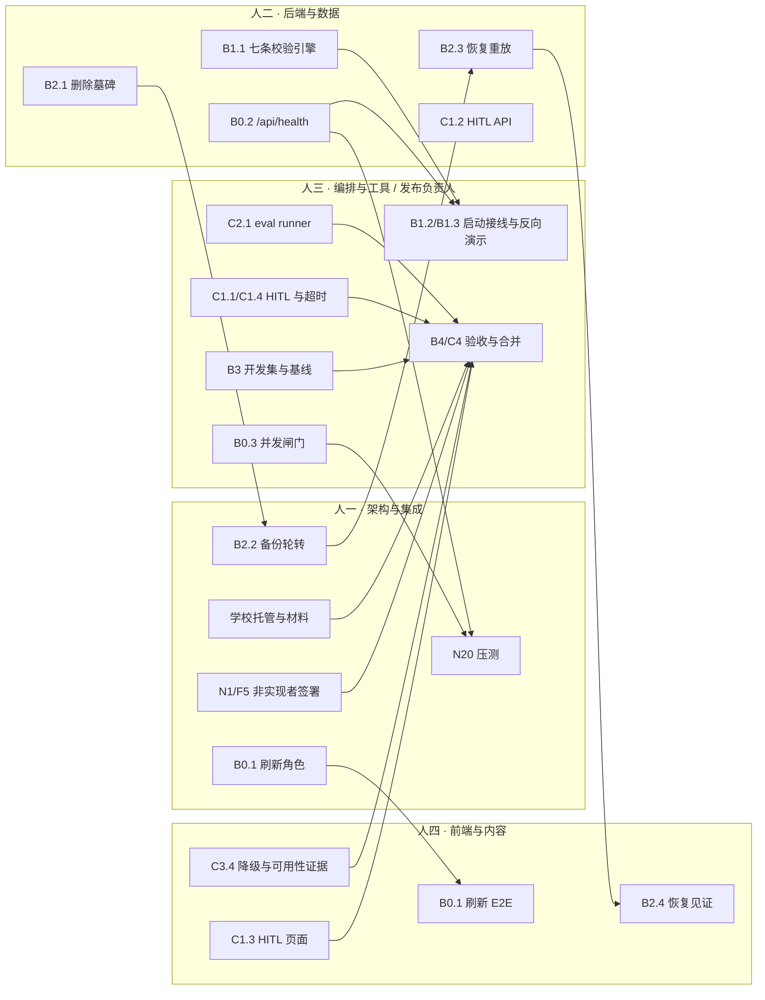

# 第三轮分工 · 阶段门 B 收尾与阶段门 C 完整任务

> ★ **本文是“投影单据”，不是正文** —— 内容全部来自 [`06-开发计划与阶段门`](06-开发计划与阶段门.md) 的 **§4（阶段门 B）**、**§5（阶段门 C）**、**§6（运维演练）** 与 **§15（第三轮任务卡）**，以及它们指向的 `docs/02`、`docs/03`、`docs/05` 与 `contracts/`。★ **冲突时一律以 `docs/06` 为准**；★ **本文不新增任何口径、不新增任何工作**。
> **用途**：发给第三轮的四个领活人。★ 本文一律用代号 **`人一`–`人四`**（与前两轮一致）—— **真实姓名不入仓**；代号 ↔ 姓名由小组在仓外维护。
> **范围**：第三轮 = **阶段门 B 收尾 + 阶段门 C**。★ 不把新的业务功能混入本轮；测试与验收证据必须可复核。

---

## 一、这一轮要做成什么

| 项 | 内容 | 出处 |
|---|---|---|
| 总目标 | 先关闭阶段门 B，再完成阶段门 C | `docs/06 §4` · §5 · §15 |
| 当前基线 | 第二轮 W1–W4 已合入；五类资产与 `MANIFEST.json` 齐备；门禁 29 项 | `docs/06 §15` |
| 阶段 B 剩余 | 刷新角色 · 七条启动校验 · 回归基线 · 备份/恢复/压测 · 删除与备份边界 | `docs/06 §4` · §15.3 |
| 阶段 C 全部 | HITL · 盲测 · 评测资产 · 四条可用性 · 证书续期 · 第二次恢复 | `docs/06 §5` · §15.4 |
| 不可破坏 | 单 worker · 同源前端 · SQLite · 25 条 path · 不降低既有契约 | `docs/02` · `docs/03` · `docs/06 §15.6` |

> ★ **本轮的完成定义以 `docs/06 §15.1` 为准**。本文第三、四章只展开“谁做什么、按什么顺序做、做完呈现什么”。

---

## 二、四个域 → 四个人

**一个人 = 一个域 = 一段别人不许直接编辑的路径**（`docs/05 §2.4` · §3）。

| 域 | 人 | 本轮主责 | 写入域 |
|---|---|---|---|
| 架构与集成 | **人一** | R1 契约/文档 · 外壳刷新 · `/api/health` 契约验收 · 门禁/CI · 备份调度 · N20 压测 · 学校材料 · N1/F5 非实现者签署 | `contracts/**` · `docs/**` · `frontend/core/**` · `frontend/index.html` · `scripts/verify.sh` · `scripts/backup.py` · `scripts/load_test.py` · `.github/**` |
| 后端与数据 | **人二** | 启动校验引擎 · `/api/health` 实现 · 删除墓碑 · 恢复读回 · HITL API · 数据面保障 | `backend/app/api/**` · `core/**` · `learning/**` · `identity/**` |
| 编排与工具 + **发布负责人** | **人三** | N20 并发闸门 · 启动/门禁接线 · 七条反向演示 · 20 道开发集与基线 · HITL 运行器 · 评测运行器 · **阶段门 B/C 最终验收与合并** | `backend/app/graph/**` · `tools/**` · `scripts/eval_verify.py`；经逐文件授权可写 `backend/app/main.py` · `scripts/verify.sh` · `backend/app/api/chat.py` · `content/eval/dev/**` |
| 前端页面与内容资产 | **人四** | 刷新 E2E · HITL 页面面 · 降级展示 · 可用性演示 · 截图与答辩材料 · 开发集内容复核 | `frontend/features/**` · `content/eval/sample/**` 的展示与验收部分 |

★ **跨域改动**：按 `docs/05 §3` 规则 1，在提交信息正文写明“经 `<域>` 同意”。★ **契约与 `docs/**` 只由 R1 人一落笔**。★★ **人三是发布负责人**：负责阶段门 B/C 的最终验收组织、合并顺序和 squash merge；**R1 契约审批仍归人一**，发布权不能绕过契约审批或写作用域。

---

## 三、阶段门 B 收尾任务

> 以下任务全部回指 `docs/06 §15.3`；判据以指到的 `§4` / `§6` / `docs/02 §8-14` 为准。

### B0 · 已知问题与接口缺口

| ID | 要做什么 | 做完应当呈现成什么样 | 主责 | 协作 |
|---|---|---|---|---|
| B0.1 | 修复刷新角色 | 令牌存在时启动调用 `GET /api/me`；成功 `setUser()`；401 清会话；刷新后顶栏显示真实角色 | 人一 | 人四验收 |
| B0.2 | 实现 `/api/health` | 无需登录；形状过 `registry.schema.json`；`db` / `corpus` / `asset_rev` / `backup` 可读；10 路并发下 < 100ms | 人二 | 人一验契约 |
| B0.3 | N20 并发闸门 | 第 11 路答疑显式 503 `server_busy`；断流和取消释放名额 | 人三 | 人二逐文件授权 `api/chat.py` · 人一压测 |
| B0.4 | GitHub ruleset 清理 | 只保留匹配 `main` 且 active 的 `mainprotect`，disabled 残留被删除 | 人一 | — |
| B0.5 | 验收模板 | 每项有命令、读数、截图或日志、失败说明 | 人一 | 人四提供截图 |

### B1 · 七条启动校验

七条对象：

1. DAG 有环
2. 条目缺 `kc_ids`
3. 题目缺 `gradable`
4. 题目缺 `answer_kind`
5. 公式名称重复
6. 文件 `rev` 与 `MANIFEST.json` 不一致
7. L1 语料缺 `license` / `source_url` / `fetched_at`

完成形态：

- 人二提供**唯一校验实现**与单测。
- **人三**把同一实现接入启动入口和 `scripts/verify.sh`（经人一逐文件授权）。
- **人三**逐条做“改坏资产 ⇒ 进程拒绝启动”的反向演示。
- 人一作为 R1 复核契约与文档。
- 不允许启动时只打印 warning，不允许测试通过但启动不校验。

### B2 · 删除墓碑、备份与恢复

边界见 `docs/02 §1.4` 与 `§11.1-12`：

- 在线数据立即删除。
- 删除前写删除墓碑。
- 备份最多保留 7 天；最新成功批次不自动删除。
- 恢复旧备份后重放墓碑，已删除账号不得复活。
- `deleteResult` 与 N15 文案同步声明这一边界。

| ID | 要做什么 | 做完应当呈现成什么样 | 主责 | 协作 |
|---|---|---|---|---|
| B2.1 | 删除墓碑 | 删除、审计、逐表读回、幂等均通过；墓碑不含内容与凭据 | 人二 | 人一审批契约 |
| B2.2 | 备份轮转 | 备份含墓碑快照；7 天轮转可验证；最新成功批次不会被误删 | 人一 | 人二复核数据 |
| B2.3 | 恢复重放 | 从旧备份恢复后，已删除账号仍不可登录、学习数据仍为 0 | 人二 | 人一见证 |
| B2.4 | 首次恢复演练 | 四张约定表逐表读回；登录与错题本可访问；证据留档 | 人一 + 人二 | 人四独立见证 |

### B3 · 回归开发集

| ID | 要做什么 | 做完应当呈现成什么样 | 主责 | 协作 |
|---|---|---|---|---|
| B3.1 | 新增 20 道入仓开发题 | 四类错因各 5 道；与冻结正式集隔离；结构化期望判据可机检 | 人三 | 人四复核内容 |
| B3.2 | 测量首次基线 | 固定开发集、固定命令，得到可复现的解题正确率 | 人三 | 人四非实现者复核 |
| B3.3 | 冻结基线 | 写入 `docs/01 §6`，只许上调；下调必须走 ADR | 人三汇总 | 人一按 R1 回写 |

### B4 · 阶段门 B 关闭

| 谁 | 要核什么 |
|---|---|
| 人一 | 角色刷新 · 健康契约 · 门禁/CI · 备份 · 压测 · N1/F5 签署 |
| 人二 | 启动校验引擎 · 健康实现 · 墓碑 · 恢复读回 · HITL API |
| 人三 | 并发闸门 · 启动接线 · 反向演示 · 开发集与基线 · 最终验收与合并 |
| 人四 | 7 页面浏览器走查 · 降级话术 · 截图和演示材料 |

★ **四人提交证据后，由人三组织阶段门 B 验收并执行 squash merge；R1 文档/契约由人一复核。**

---

## 四、阶段门 C 任务

### C1 · HITL

| ID | 要做什么 | 做完应当呈现成什么样 | 主责 | 协作 |
|---|---|---|---|---|
| C1.1 | HITL 运行器与超时 | 验证重算一次仍 `uncertain` 时挂起；超时后 `hitl.resolved(action="timeout")` → `done(status="uncertain")` | 人三 | 人二复核状态/身份 |
| C1.2 | HITL API | `POST /api/runs/{id}/hitl` 接收 `{action, final?}`；归属错误 404，状态/动作错误 409 | 人二 | 人三提供 run 语义 |
| C1.3 | HITL 页面面 | 挂起、继续/取消、超时四态可见；按钮来自 `options`，不得写死 | 人四 | 人三提供帧契约 |
| C1.4 | 超时实测 | 真实链路测定后写回 `PROBCREW_HITL_TIMEOUT_S` 正式默认值 | 人三 | 人一审批配置 |

### C2 · 评测与盲测

| ID | 要做什么 | 做完应当呈现成什么样 | 主责 | 协作 |
|---|---|---|---|---|
| C2.1 | `scripts/eval_verify.py` | 可跑 sample/dev/frozen；报告不含凭据和正式集答案 | 人三 | 人一同步门禁 |
| C2.2 | 样例集 E2E | 现有 3 道样例真实执行并进入门禁 | 人一 | 人三执行 · 人四看降级 |
| C2.3 | N1 正式盲测 | 20 道、四类各 5、至少 8 道 A/B 可达；非实现者签署 | 人一 | 人三提供运行器 |
| C2.4 | F5 正式盲测 | 命中率与分类地板达标；负样本不得编造错因；非实现者签署 | 人一 | 人二、人四提供环境 |

### C3 · 可用性与运维

| ID | 要做什么 | 做完应当呈现成什么样 | 主责 | 协作 |
|---|---|---|---|---|
| C3.1 | 单机完整 | 登录、判定、答疑、知识全通 | 人一 | 四域参加 |
| C3.2 | 单机离线 | 本机端点断网仍可完成答疑 | 人三 | 人四验收 |
| C3.3 | 远程完整 | 学校托管下 HTTPS/HSTS、身份、答疑全通 | 人一 | 人二、人三 |
| C3.4 | 降级模式 | 无凭据时非答疑能力可用，答疑显式不可用 | 人四 | 人三 |
| C3.5 | 证书续期 | 临期证书续期后 HTTPS/HSTS 立即复测 | 人一 | 人四复测 |
| C3.6 | 第二次恢复演练 | 恢复与墓碑重放再次通过并留档 | 人一 + 人二 | 人四见证 |

### C4 · 阶段门 C 关闭

- 正式集盲测有非实现者签署结论。
- 四条可用性演示均有命令、读数和证据。
- 证书续期与第二次恢复演练有留档。
- 阶段门 A、B 重跑仍绿。
- 学校托管或证书未落实时，C3.3 / C3.5 保持阻塞，不得伪造通过。
- 全部完成后，**人三组织阶段门 C 最终验收和 squash merge**；人一完成 R1 文档/契约复核与 N1/F5 签署。

---

## 五、开工阻塞依赖图

### 5.1 四人并行分工图（泳道）



> **读法**：横向是四条域内工作流；箭头只画跨域交接，不表示责任人可以越界写文件。

### 5.2 开工阻塞依赖图

```text
并行车道 1（人一）
  刷新角色 ───────────────────────────────────────────────┐
  备份轮转（依赖墓碑接口） ───────────────────────────────┤
  N20 压测（依赖健康 + 并发） ───────────────────────────┤
  N1/F5 非实现者签署 ────────────────────────────────────┤
                                                          │
并行车道 2（人二）                                        │
  /api/health ───────────────┐                            │
  七条校验引擎 ──────────────┼──────────────┐              │
  墓碑与恢复数据面 ──────────┼──────────────┼── 首次恢复 ──┤
  HITL API（待运行器语义） ──┘              │              │
                                            │              │
并行车道 3（人三 · 发布负责人）              │              │
  并发闸门（经人二授权） ───────────────────┘              │
  启动/门禁接线 + 反向演示 ────────────────────────────────┤
  20道开发集 + 基线测量 + 冻结 ────────────────────────────┤
  HITL 运行器 + eval runner ──────────────────────────────┤
                                                          ▼
                                                  阶段门 B 验收与合并
                                                          │
并行车道 4（人四）                                        │
  刷新 / HITL / 降级页面验收 ──────────────────────────────┤
  恢复演练独立见证 · 四条可用性证据 ──────────────────────┘
                                                          │
                                                          ▼
阶段 C：HITL + eval runner + 四条可用性 + 正式盲测
       + 证书续期 + 第二次恢复演练
                          │
                          ▼
                  阶段门 C 最终验收与合并（人三）
```

**降低串行的接口冻结点**：

1. 人二先冻结 `/api/health` 响应和启动校验函数签名；人三并行写入口接线。
2. 人二先冻结 `api/chat.py` 的并发钩子；人三并行写 runner 闸门。
3. 人二先冻结墓碑记录格式；人一并行写备份轮转，之后汇合恢复重放。
4. 人一提供 `hitlResolvedPayload` 契约语义；人二、人三、人四并行实现 API、运行器和页面。
5. 人三冻结 `eval_verify.py` 报告格式；人一并行准备正式集执行环境。

★ **阻塞读数**：

- 角色刷新未完成 ⇒ 阶段门 B 不能关闭。
- 删除边界未落墓碑/恢复重放 ⇒ 不能执行正式恢复演练。
- `/api/health` 或第 11 路 503 未完成 ⇒ N19/N20 不能计通过。
- 正式 N1/F5 必须在阶段门 B 关闭后执行。
- 学校托管未落实 ⇒ 远程完整、证书续期保持阻塞。

---

## 六、本轮结束时的整体形态

### 阶段门 B

- 刷新页面后角色恢复，主链路数据仍可读。
- `/api/health` 与七条启动校验生效。
- 删除墓碑、7 天备份、恢复重放、首次恢复演练全部留档。
- 10 路答疑、11 路 503、断流和复合压测通过。
- 20 道开发集基线已冻结。
- 全量门禁、CI、294+ 用例与浏览器 E2E 全绿。

### 阶段门 C

- HITL 挂起/继续/取消/超时四态可用。
- eval runner 可运行样例集和冻结正式集。
- N1/F5 正式盲测有非实现者签署。
- 四条可用性演示完成。
- 证书续期、第二次恢复演练完成。
- 阶段门 A、B 重跑仍绿。

---

## 七、边界：这一轮不做什么

**沿用既有边界，不新增为“顺手做”**：

- 不做注入式探针、读屏、划词、驱动宿主动画。
- 不做 PDF 阅读器与教材精确定位。
- 不做跨用户聚合、成绩分析报表、掌握度热力图。
- 不做屏幕阅读器完整支持。
- 不做多 worker、水平扩展、高可用。
- 不做异地 / 多副本备份。
- 不做排队限流；第 11 路显式 503。
- 不做证书自动化与 HSTS 预加载。
- 不引入外部 checkpointer；HITL 仍使用当前内存 run。

---

## 八、负载明账与共享约定

| 项 | 明账 |
|---|---|
| 关键路径 | **人二、人三**：人二卡 API/数据面，人三卡并发、启动接线、基线、评测与最终发布；人一提供 R1、运维和独立签署支持 |
| 人三 | **发布负责人**：并行推进 B 的多项任务，组织阶段门 B/C 最终验收与 squash merge |
| 人四 | 页面验收、降级展示、截图与答辩材料；不替别域实现后端 |
| 分支 | 一人一分支，`<域>/<主题>`；失败就补测，不靠口头通过 |
| 合并 | 走 PR + squash；合并前三件事见 `docs/05 §7.2` |
| 跨域 | 提交信息正文写明“经 `<域>` 同意” |
| 契约 | 先提案、R1 审批、schema 内记账、同步 consumer |
| 记录 | 每个工作包更新 `_plan/data.md` 与对应验收留档 |

---

> ★ **再次声明**：本文是投影。任务、判据、边界的唯一权威是 `docs/06 §15`（配合 `docs/02` · `docs/03` · `docs/05`）；本文若与它们不一致，**以 `docs/06` 为准**，并请按 `docs/06 §15` 回写差异。
